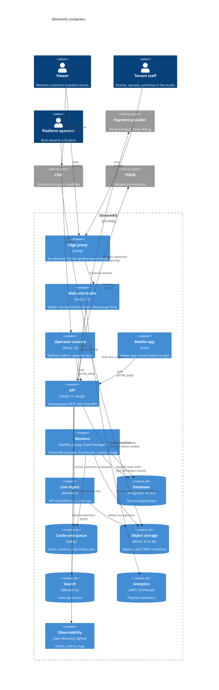

# Architecture overview — StreamKit (netflix-clone)

| Field         | Value                                                    |
| ------------- | -------------------------------------------------------- |
| Date          | 2026-10-28                                               |
| One-liner     | White-label, multi-tenant streaming SaaS (VOD and live)  |
| Detail design | [TDD.md](./TDD.md) (modules, data, flows, failure modes) |
| Requirements  | [SRS.md](./SRS.md)                                       |
| Decisions     | [adr/](./adr/)                                           |

This file is a **text flowchart overview only**. It is not a second TDD.
Today's code is the single-tenant demo (Express, Prisma, one catalog). This page shows the
**target** the plans in [PLAN.md](./PLAN.md) build. Where the repo differs, TDD section 13 says how.

## System context

```text
   viewers (web, mobile, TV)        tenant staff (studio)        platform operators
              |                              |                           |
              v                              v                           v
      brand.example.com  /  tenant.streamkit.app  (Host header = tenant)
                                   |
                                   v
                       +-----------------------+
                       |       StreamKit       |
                       | one deployment, many  |
                       | tenants, RLS-isolated |
                       +-----------+-----------+
                                   |
        +--------------+-----------+-----------+---------------+
        v              v                       v               v
   payment provider   object storage / CDN   TMDB (metadata)   email / push
   (Stripe Connect)   (MinIO, R2, B2, Bunny)  enrichment only   providers
```

## Request flow (happy path)

```text
Viewer
  -> Caddy (TLS for any verified tenant host)
    -> apps/web  proxy.ts: Host -> tenant lookup (Valkey cache) -> tenant context
      -> apps/api  TenantGuard -> AuthGuard -> EntitlementGuard
        -> service  (withTenant: set_config app.tenant_id, transaction-local)
          -> Postgres RLS filters every row to the tenant
    <- signed manifest URL (JWT/HMAC, 5 min)
  -> CDN / object storage  (segments never touch the API)
```

## Main components

| Box                      | Responsibility                                                                                                                                                 | Owns FRs                       |
| ------------------------ | -------------------------------------------------------------------------------------------------------------------------------------------------------------- | ------------------------------ |
| apps/web                 | Viewer site, tenant studio, branded per host. Next.js 16.                                                                                                      | FR-CORE-1..8, FR-WL-1..8       |
| apps/admin               | Platform operator console (separate auth).                                                                                                                     | FR-TEN-6, FR-TEN-8             |
| apps/mobile              | Viewer app, brand loaded at start. Expo.                                                                                                                       | FR-CORE-12, FR-WL-5, FR-VOD-10 |
| apps/api                 | NestJS 11 on Fastify. Modules: identity, tenancy, branding, catalog, assets, playback, entitlements, billing, engagement, live, search, analytics, compliance. | most FRs                       |
| apps/worker              | BullMQ workers: transcode, package, thumbnails, outbox, usage, DSAR.                                                                                           | FR-VOD-2..6, FR-OPS-7          |
| Postgres 18 + RLS        | One database, `tenant_id` on every tenant row.                                                                                                                 | FR-TEN-2                       |
| Valkey                   | Cache, queues, sessions, rate limits, host-to-tenant map.                                                                                                      | FR-BIL-5                       |
| Object storage           | Masters and CMAF renditions. MinIO in dev.                                                                                                                     | FR-VOD-1, FR-VOD-4             |
| MediaMTX                 | Live ingest (SRT, RTMP) and LL-HLS out.                                                                                                                        | FR-LIVE-2, FR-LIVE-3           |
| Meilisearch              | One index per tenant.                                                                                                                                          | FR-OPS-4                       |
| NATS to ClickHouse       | Playback telemetry.                                                                                                                                            | FR-VOD-11, FR-OPS-3            |
| OTel Collector to SigNoz | Traces, metrics, logs.                                                                                                                                         | FR-OPS-1, FR-OPS-2             |

## Trust and tenancy boundaries

```text
[ Tenant A rows ] ----X---- [ Tenant B rows ]
        ^                          ^
        +-- enforced by Postgres RLS (FORCE) + non-owner app role --+
            plus the application guard. Either one alone is not trusted.

[ viewer token ] ----X---- [ staff token ] ----X---- [ platform admin token ]
   separate issuers, tables and secrets; a token never crosses a boundary.
```

## C4 container view



## Non-goals for this diagram

- Endpoint catalogs, table DDL, class lists: **TDD.md**
- Phased build order: **PLAN.md**
- Requirement text: **SRS.md**
